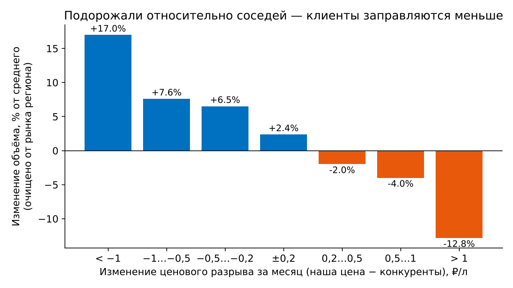
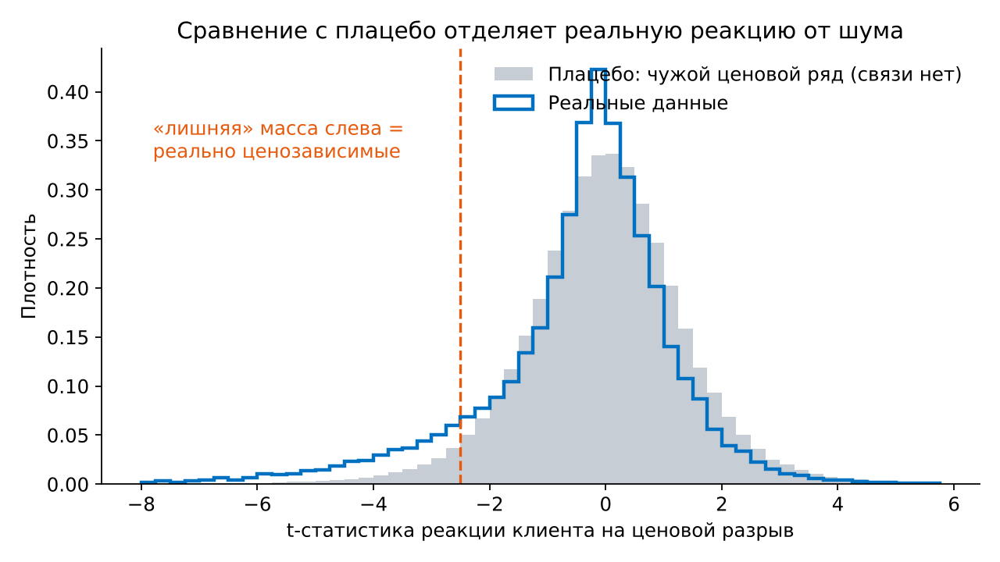
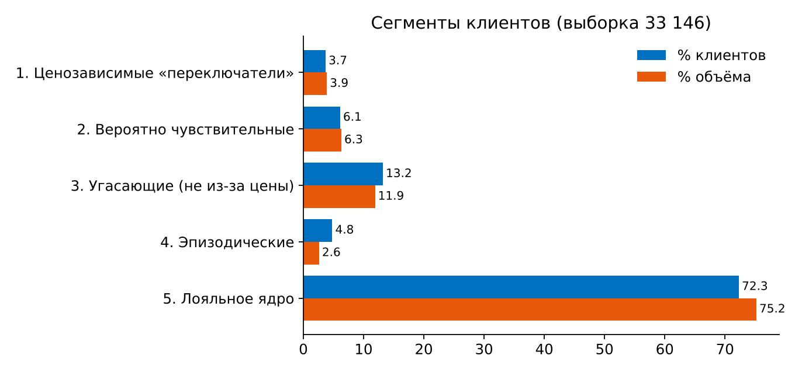
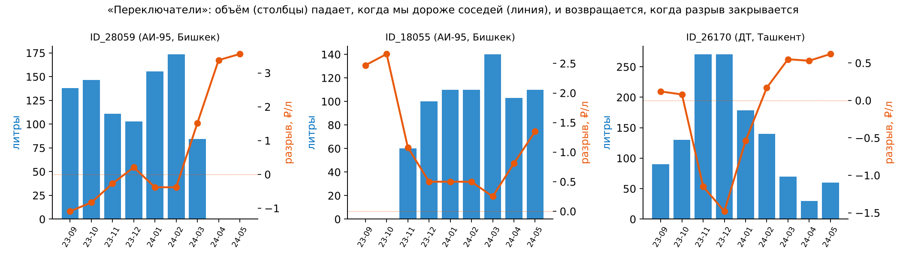
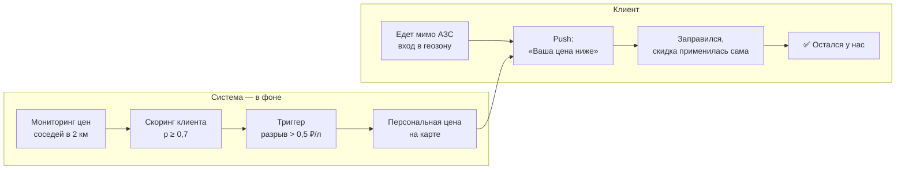
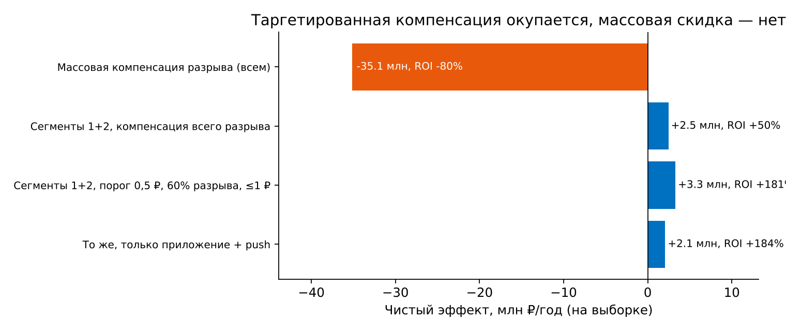

# Эластичность спроса: кто уезжает к соседу за 50 копеек

Решение кейса **«Эластичность спроса»** чемпионата Intelligence Cup от «Газпром нефти».

Задача: найти внутри «текущих» клиентов программы «Нам по пути» тех, кто заправляется там, где дешевле, предложить механики их удержания через мобильное приложение и посчитать экономику.

## Главное за минуту

- **Связь есть.** +1 ₽ ценового разрыва с соседями даёт **−10,9%** объёма заправок (≈ −5,4% на 50 копеек) после очистки от сезонности и регионального тренда.
- **Наивный поиск врёт.** Регрессия по 9 точкам на клиента и порог p-value на плацебо-данных дают ~70% ложных находок. Мы калибруем вероятность ценозависимости по плацебо (local FDR).
- **Когорта небольшая.** Реально ценозависимы около **2 490 клиентов (7,5%)**. Ядро из **1 214 «переключателей»** теряет ~44% объёма при +0,5 ₽ разрыва и возвращает его, когда разрыв закрывается. Ложных попаданий в этом сегменте около 21%.
- **Скидка всем убыточна, адресная окупается.** Массовая компенсация разрыва даёт −35 млн ₽/год на выборке. Компенсация 60% разрыва (не больше 1 ₽/л) только сегментам 1–2 и только когда мы дороже соседей на 0,5 ₽ и больше даёт **+3,3 млн ₽/год, ROI +181%**. Это **≈ 100 тыс. ₽/год на 1 000 клиентов**.

<p align="center"></p>

## Решение по задачам кейса

| Задача | Документ | Ключевой результат |
|---|---|---|
| 1. Выявление ценозависимых клиентов | [docs/01_methodology.md](docs/01_methodology.md) | TWFE-связь, 6 показателей чувствительности, плацебо-калибровка, 5 сегментов, проверки устойчивости |
| 2. Маркетинговые механики | [docs/02_marketing.md](docs/02_marketing.md) | механика для каждого сегмента, оффер «Ваша цена рядом», клиентский путь «Было → Стало» |
| 3. Экономический эффект | [docs/03_economics.md](docs/03_economics.md) | сценарии, чувствительность к допущениям, масштабирование |

### Сегменты

| Сегмент | Клиентов | % объёма | Эффект +0,5 ₽ | Что делаем |
|---|---:|---:|---:|---|
| 1. Ценозависимые «переключатели» | 1 214 (3,7%) | 3,9% | −44% | персональная компенсация разрыва |
| 2. Вероятно чувствительные | 2 029 (6,1%) | 6,3% | −36% | тот же оффер через A/B-тест |
| 3. Угасающие (не из-за цены) | 4 373 (13,2%) | 11,9% | ≈ 0 | win-back без топливной скидки |
| 4. Эпизодические | 1 578 (4,8%) | 2,6% | — | механики частоты |
| 5. Лояльное ядро | 23 952 (72,3%) | 75,2% | −2% | нематериальная ценность, без скидок |

<p align="center">
  
  
</p>
<p align="center"></p>

### Клиентский путь «Стало»



<p align="center"></p>

## Как запустить

```bash
pip install -r requirements.txt
# положите файл кейса в data/case_data.xlsx (или .xlsb), см. data/README.md
python scripts/run_pipeline.py --data data/case_data.xlsx --out results
# или: make run · make test
```

Расчёт занимает меньше минуты. Все пороги и допущения собраны в [`src/pricesens/config.py`](src/pricesens/config.py). Допущение о доле возврата объёма можно поменять из CLI: `--recovery 0.4`.

Пакет можно установить (`pip install -e .`) и запускать командой `pricesens --data ...`.

## Результаты (`results/`)

| Файл | Содержимое |
|---|---|
| `segmentation_results.xlsx` | сегменты, экономика с блоком масштабирования на формулах, чувствительность, **метрики и сегмент каждого клиента**, эффекты по разрезам, устойчивость, сетка порогов |
| `summary.json` | ключевые числа для презентации |
| `segments_summary.csv`, `scenarios.csv` | сводки в плоском виде |
| `figures/*.png` | графики для слайдов |

## Структура

```
├── src/pricesens/
│   ├── config.py         # пороги сегментации, калибровки и экономики
│   ├── io.py             # чтение и разбор файла кейса
│   ├── features.py       # индекс объёма, очистка от рынка
│   ├── aggregate.py      # 1.1 TWFE, эффекты по разрезам, бины изменений
│   ├── metrics.py        # 1.2 полуэластичность, тренд, реакция на шоки, EB-сжатие
│   ├── calibration.py    # 1.2 плацебо и local FDR → вероятность ценозависимости
│   ├── segmentation.py   # 1.3 правила сегментации
│   ├── robustness.py     # 1.5 плацебо, jackknife, две половины периода, сетка порогов
│   ├── economics.py      # 3   маржа на литр, недобор, симуляция офферов
│   ├── plots.py, report.py
│   ├── pipeline.py       # весь конвейер
│   └── cli.py
├── scripts/run_pipeline.py
├── tests/test_pricesens.py  # синтетические данные с заложенным эффектом
├── docs/                    # методология, механики, экономика
├── data/                    # сюда кладутся данные кейса (не коммитятся)
└── results/                 # готовые результаты
```

## Тесты

```bash
python -m unittest discover -s tests -v
```

Тесты строят синтетическую панель с заранее известной долей ценозависимых клиентов и проверяют четыре вещи: TWFE восстанавливает средний эффект; сумма вероятностей близка к истинному числу чувствительных; сегмент 1 имеет точность выше 85%; адресный оффер выгоднее массового.

## Ограничения

Индивидуальные оценки строятся всего по 9 месячным точкам. В данных нет транзакций и геоданных, цена конкурентов усреднена по окружению, а разрыв может быть эндогенным. Причинный эффект оффера нужно подтвердить A/B-тестом.
