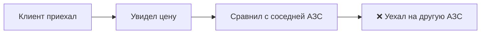
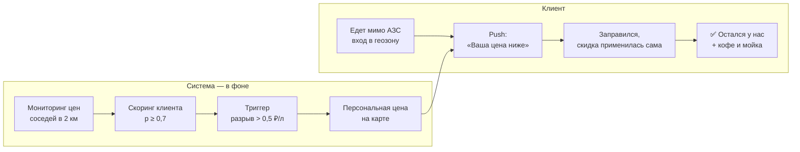

# Задача 2. Маркетинговые механики и клиентский путь

## Принцип

Скидка нужна только там, где она меняет поведение. Компенсация разрыва всем клиентам субсидирует 90% объёма, который никуда бы не ушёл (см. [экономику](03_economics.md)). Поэтому механика различается по сегментам.

| Сегмент | Механика | Чего не делаем |
|---|---|---|
| 1. «Переключатели» | **«Ваша цена рядом»**: если наша АЗС дороже соседей более чем на 0,5 ₽/л, клиенту автоматически начисляется компенсация бонусами — 60% разрыва, не больше 1 ₽/л | не даём скидку, когда мы дешевле соседей |
| 2. Вероятно чувствительные | тот же оффер в формате **A/B-теста** на половине сегмента. Откликнувшиеся переходят в сегмент 1, тест измеряет реальную долю возврата | не раскатываем на всех без теста |
| 3. Угасающие | win-back без топливной скидки: короткий опрос о причине, бонус на кофе/мойку, проверка смены маршрута | не тратим ценовой бюджет — причина не в цене |
| 4. Эпизодические | механики частоты: «3-я заправка в месяце — бонусы ×2», напоминание о визите | — |
| 5. Лояльное ядро | нематериальная ценность: статусы, сервис, СТиУ; защита ценовой позиции на уровне сети | персональных скидок на топливо нет |

## Доставка через приложение без действий клиента

1. **Ночной расчёт.** Мониторинг цен конкурентов в радиусе 2 км от каждой АЗС, пересчёт вероятности ценозависимости.
2. **Триггер.** Для пары «клиент × его основная АЗС» разрыв > 0,5 ₽/л → персональная цена записывается на бонусную карту.
3. **Геозона.** Когда клиент с приложением въезжает в радиус 2 км от АЗС, приходит push: «Сегодня для вас −0,6 ₽/л на АЗС на Ленина — уже на карте».
4. **Оплата.** Скидка применяется на кассе/в «Заправке в приложении» автоматически — без промокодов и активаций.
5. **Обратная связь.** Факт заправки обновляет модель: если клиент приезжает и без оффера — его вероятность снижается.

Охват: у 60% клиентов сегментов 1–2 есть приложение и согласие на push. Остальные получают ту же цену на карте и узнают о ней через SMS/e-mail (согласия есть почти у всех).

## Клиентский путь

**Было**

**Стало**

Итог для клиента — фраза из условия кейса: «Они понимают меня. Я заправлюсь здесь».

## Метрики механики

- Доля возвращённого объёма (по A/B: тест vs контроль внутри сегментов 1–2).
- Затраты на 1 возвращённый литр (цель — ниже маржи ~10 ₽/л; в расчёте ≈ 3,5 ₽/л).
- Доля «заправок у соседей»: падение объёма в месяцы роста разрыва у тестовой группы.
- Отток из сегмента 1 в «Угасающие».
